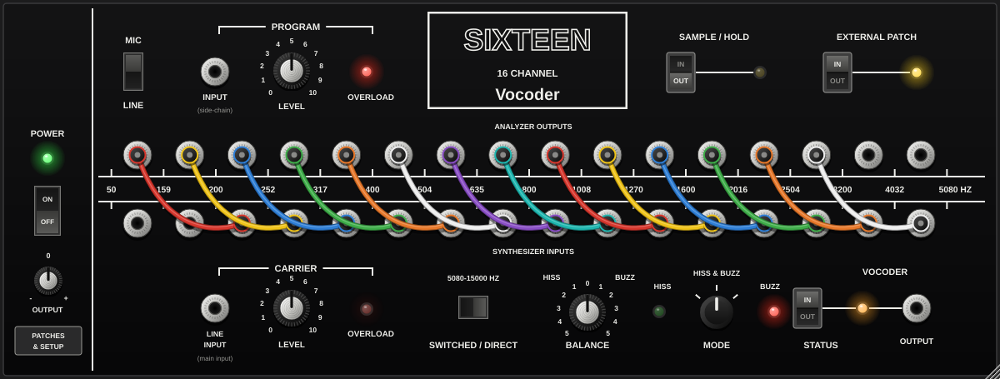

# Sixteen: a circuit model of the classic 16-channel analog vocoder



Sixteen is a VST3 effect modelled on the 16-channel vocoder designed by Harald Bode (Bode Vocoder
model 7702) and later built under licence by Moog Music. It has two audio inputs, as the hardware does:
a **PROGRAM** (the voice) and a **CARRIER** (synth, guitar, any sound). Cubase feeds the second input
through the plugin's side-chain.

The DSP isn't a generic vocoder. It's built from the **component values on the original schematic**
(Bode manual, control board 7702-4C and filter board 7702-3C). Every filter is computed from the
resistors and capacitors in the circuit, then converted to digital form so its centre frequency
and Q come out the same at any sample rate.

The panel layout follows the original front panel. The nameplate uses plain generic lettering in
place of the original maker's logo, since that logo is a registered trademark.

## Using it in Cubase (12 or newer)

1. Insert **Sixteen** on the track that holds the **carrier**, usually an instrument track with a
   synth (a bright sawtooth or a narrow pulse wave works best).
2. In the plugin window, click the **side-chain** button (the arrow icon in the header) to turn on
   the side-chain input.
3. On the **vocal** track, add a send (or set the output routing) to *Sixteen – Side-Chain*.
   In Cubase 12 and later you can also use *Add Side-Chain Source* from the plugin window's
   side-chain menu.
4. Set the two **LEVEL** knobs so the **OVERLOAD** lamps just flicker on peaks, as the original
   manual recommends. The vocoder is calibrated to sound best near overload.

A vocoder is silent without a voice: the carrier only sounds where the voice has energy. If no
voice reaches the plugin, a red **NO VOICE** banner appears across the panel and tells you what to
check. The usual causes are:

- **The side-chain isn't activated** in the plugin window header.
- **The send on the vocal track isn't on, or its level is at −∞.**
- **The send points at a different destination.** It should go to *Sixteen – Side-Chain*.

The small text under the PROGRAM and CARRIER jacks also shows where each signal comes from.

If you'd rather insert it on the **vocal** track and side-chain the synth, open
**PATCHES & SETUP → Inputs** and choose *Program = main input, Carrier = side-chain*.

## Controls

| Control | What it does |
|---|---|
| **MIC / LINE** | MIC adds 20 dB of gain to the program input (for quiet sources) |
| **PROGRAM LEVEL**, **CARRIER LEVEL** | Input gain, 3.6 dB per division: 5 = +12 dB, so a track peaking around −12 dBFS just lights the OVERLOAD lamp, which is where the vocoder works best. 10 = +30 dB for quiet tracks. The preamps saturate softly about 4 dB above the lamp threshold, as on the hardware. Below the threshold the lamps glow faintly with the input level |
| **OUTPUT** | Output trim, ±24 dB. This isn't on the original panel. Like the hardware, the vocoded level follows voice level × carrier level, so 6 dB less on both inputs gives about 12 dB less output. Set the inputs with the lamps first, then use OUTPUT |
| **SAMPLE / HOLD** | IN freezes the 16 control voltages, so a vowel sustains for as long as you like. Your MIDI sustain pedal (CC64) works as the foot switch, if you route MIDI to the plugin |
| **EXTERNAL PATCH** | IN: the patch cords decide which analyzer band controls which synthesizer band. OUT: the normal 1:1 connection (cords stay plugged in but are ignored, as on the hardware) |
| **Patch cords** | Drag from an *analyzer output* jack to a *synthesizer input* jack. Drag a plug away to remove it. You can also drag from an empty synthesizer input up to an analyzer output |
| **5080–15000 HZ: SWITCHED / DIRECT** | The extra high-frequency channel passes the program's top end for intelligibility. DIRECT: always on. SWITCHED: only during "s" and "t" sounds |
| **BALANCE** | Hiss (noise) against buzz (carrier) for the synthesizer bands |
| **MODE** | HISS: only the unvoiced sounds (noise). HISS & BUZZ: normal. BUZZ: only the voiced sounds (carrier); all hiss, including the HF channel, is suppressed |
| **HISS / BUZZ lamps** | The voiced/unvoiced discriminator, which runs all the time |
| **STATUS** | OUT bypasses the vocoder: the program passes straight through, like the hardware's "public address" mode |
| **POWER** | Mutes the output |

Every control is a plugin parameter, so all of it can be automated in Cubase.

### Patch presets (PATCHES & SETUP → Patch cords)

These are the cross-patches from the original manuals. Selecting one also sets EXTERNAL PATCH to IN.

| Patch | Source | Effect |
|---|---|---|
| Chipmunk / Donald Duck | Bode patch sheet 1, Moog manual p. 9 | Analyzer *n* → synth *n+2*: raises the formants |
| Formants Down | Bode patch sheet 1 | Analyzer *n+2* → synth *n*: lowers the formants |
| Space Robot | Moog manual p. 8 | Low bands sent to the top, middle bands to the bottom |
| Single / Double Cluster X | Bode patch sheet 1 | Speech scrambling "close to an instrumental sound" |
| Single / Double Cluster Inverter | Bode patch sheet 2 | Mirrors the spectrum |
| Straight (1:1), No Cords | | Starting points for your own patches |

## What's modelled, and how

### Filter bank (analyzer and synthesizer, identical)

The panel numbers are the **band edges**, not centre frequencies. Each band covers the space
between two numbers: channel 1 is 50–159 Hz, channel 2 is 159–200 Hz, and so on up to channel 16 at
4032–5080 Hz.

- **Channels 2–16** each use two cascaded *multiple-feedback* op-amp band-pass stages. Each stage
  has Q ≈ 7.8, and the second stage is tuned about 18 % higher than the first (stagger tuning). The
  result is a flat-topped 1/3-octave band with a slight double hump, skirts reaching about 20 dB down
  one third-octave outside the band, and 12 dB/octave asymptotic slopes. The capacitors halve every
  three channels (20 nF, 10 nF, 5 nF, 2.5 nF), and the resistor sets repeat, as on the original
  filter board.
- **Channel 1** is a 4-pole low-pass made of two Sallen-Key stages (56 k, 22 nF, 10 nF:
  191.6 Hz, Q 0.74 each), −3 dB at about 160 Hz.

The computed −3 dB edges match the panel legends to within a few percent; the test suite checks
this at 44.1, 48, 96 and 192 kHz:

| ch | panel | stage 1 | stage 2 | modelled −3 dB band |
|---|---|---|---|---|
| 1 | 50–159 | LP 191.6 Hz Q 0.74 | LP 191.6 Hz Q 0.74 | DC–164 Hz |
| 2 | 159–200 | 164.7 Hz Q 7.76 | 194.9 Hz Q 7.76 | 159–201 Hz |
| 5 | 317–400 | 329.4 Hz | 389.7 Hz | 319–403 Hz |
| 9 | 800–1008 | 836.6 Hz | 990.5 Hz | 809–1024 Hz |
| 13 | 2016–2504 | 2127 Hz | 2492 Hz | 2060–2570 Hz |
| 16 | 4032–5080 | 4166 Hz | 4992 Hz | 4028–5162 Hz |

(The test output lists all 16 channels.)

### Envelope followers

These are precision full-wave rectifiers whose summing amplifier doubles as an RC integrator,
followed by a 2-pole Sallen-Key smoothing filter:

- Channels 2–16: a 79.6 Hz pole, then 48.8 Hz at Q 0.60. The 10–90 % rise time is about 9 ms; the
  Bode brochure quotes "in the order of 6 ms".
- Channel 1 is much slower (18 Hz, then 7.7 Hz), so it doesn't follow the waveform of its own
  50–159 Hz band.

### Synthesizer VCAs

These are CA3080 OTAs whose gain is linear in the control voltage. Their small tanh nonlinearity
gives the slight thickening of a hot carrier.

### Hiss/buzz discriminator

The program is split at about 1.85 kHz (a Sallen-Key low-pass and high-pass). Each half is
rectified and smoothed (79.6 Hz, then 101 Hz), and an integrating comparator decides between voiced
and unvoiced. Its outputs charge the gate capacitors: about 0.1 ms attack, 10 ms release, and a
diode threshold. Those gates switch:

- the carrier (buzz)
- the built-in noise generator: avalanche-junction noise, high-passed at about 330 Hz (hiss)
- the high-frequency channel, when it's set to SWITCHED

### Other stages

- **HF channel:** a Butterworth high-pass at 5029 Hz with a gain of 1.59, then a Butterworth
  low-pass at 15.0 kHz.
- **259 Hz pre-filter:** a 2-pole high-pass in front of the analyzer and discriminator. The
  schematic marks it "added above S/N 108", so it's on by default; turn it off in
  PATCHES & SETUP for an early unit.
- **Output levels:** the vocoded path is calibrated so that, with both inputs at the lamp threshold,
  the output comes out at about the voice's own level. The HF channel and STATUS OUT (bypass)
  carry the program at its input level, so "s" sounds keep their natural balance against the
  vowels.

### Estimates

A few gain-staging values aren't legible on the schematic, so these are calibrated estimates:

- how hard the carrier drives the OTA input: 40 mV peak at the overload threshold
- the noise level against the carrier
- the comparator's offset trim, which leans towards BUZZ in silence so that SAMPLE/HOLD keeps
  sounding

They live in `dsp/Circuit.h` and `dsp/VocoderEngine.h`.

The hardware is mono. Sixteen sums stereo inputs to mono and sends the same signal to both output
channels.

## Building and testing

The vocoder builds as part of the repository's CMake project. Its targets are:

- `Sixteen_VST3` and `Sixteen_Standalone`: the plugin
- `sixteen_test`: the DSP tests, which also write `vocoder_demo_*.wav` to the build directory

```
cmake -B build -DCMAKE_BUILD_TYPE=Release
cmake --build build --target Sixteen_VST3 sixteen_test
ctest --test-dir build -R sixteen
```

The GitHub Actions build produces a **Sixteen-Vocoder-Windows-x64** artifact. Copy
`Sixteen.vst3` from it to `C:\Program Files\Common Files\VST3\` and rescan in Cubase. The
**Sixteen-demo-audio** artifact has demo renders: normal, chipmunk, space robot and buzz-only,
using a synthetic test voice.

`-DSIXTEEN_BUILD_SCREENSHOT=ON` adds `sixteen_screenshot`, which renders the editor to a PNG. Run
with `--process`, it pushes audio through the plugin's main and side-chain buses as a quick check.
